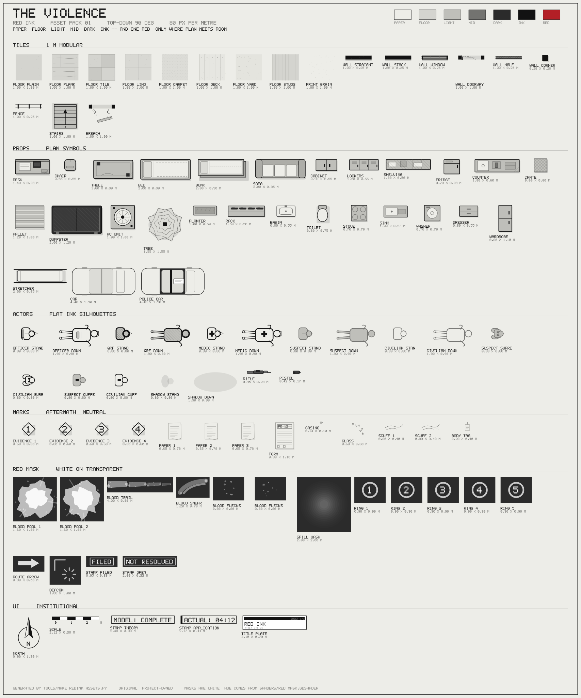

# Red ink — asset pack 01

**98 files:** 18 tiles, 28 props, 18 actors and weapons, 13 aftermath marks, 16 masks, 5 UI plates.

The top-down (90°) art kit for **The Violence**, built to the house red-ink art direction: red is the only colour, it lives in a separate
mask layer, and every red mark carries a second cue so the monochrome proof
survives.



| Sheet | What it shows |
| --- | --- |
| `contact_sheet.svg` | every asset at native scale, with its file name and real size in metres |
| `state_sheet.svg` | the demo room in both states — theory beside application, one topology |

Both sheets are generated, not hand-drawn: they cannot drift from the pack.

## Build it

```bash
python3 tools/make_redink_assets.py            # write assets/redink + both sheets
python3 tools/make_redink_assets.py --check    # palette and layer audit, then sizes
python3 tools/make_redink_assets.py --list     # every asset path
```

Stdlib only, deterministic, no fonts and no filters (Godot's SVG import drops
`<text>` and is unreliable with filter gradients, so all lettering is a 5×7 bitmap
of `rect`s). Files are authored at **80 px per metre**; the game world is 40 px/m,
so sprites are placed at scale 0.5. Actors face **+x** (Godot rotation 0).

## Look at it in Godot

```bash
godot --path . res://tests/redink_gallery.tscn
```

| Key | |
| --- | --- |
| `Space` | red ink on/off (monochrome proof) |
| `G` | gore on/off — stains go, evidence markers and forms stay |
| `1` / `2` or `R` | theory / application |
| `H` | hide the plan guides |

```bash
godot --headless --path . -s res://tests/redink_test.gd -- --verbose
```

The audit imports every file through Godot's own SVG importer, then checks sizes,
that masks are white, that base art is neutral, that both states share a topology,
that theory holds no blood, that the blood stays inside a few percent of the floor,
and that `Ink.accent()` never shifts hue with alpha and greys out when red is off.

## Layers

Draw order, and the folder each layer comes from:

```
floor tiles            tiles/floor_*
spill washes           masks/spill_wash          (red mask, under everything)
grid, grit             drawn by the map view
blood layer            masks/blood_*             (red mask)
walls                  tiles/wall_*, tiles/fence
furniture, props       props/
room labels            UI, bitmap lettering
actors                 actors/*_stand, *_surrender, *_cuffed, *_down
evidence + annotations marks/, masks/ring_*, masks/route_arrow, masks/beacon
```

1. **Base** — neutral floors, walls, furniture, flat silhouettes. No red, ever.
2. **Ink** — outlines, hard cast shadows (Dark at ~0.16 alpha), sparse hatching.
3. **Red mask** — `assets/redink/masks/`, white on transparent. Routes, numbered
   rings, alarms, spill and blood. The hue comes from `Ink.accent()` or
   `shaders/red_mask.gdshader`; the files themselves never contain red.
4. **Print** — `tiles/print_grain.svg`, a neutral grain pass for backgrounds.

## Palette

| Token | Hex | Use |
| --- | --- | --- |
| Paper | `#EDEDE8` | page, chips, bright cut-outs |
| Floor | `#D4D4CF` | room base |
| Light | `#BFBFBA` | furniture tops, equipment marks |
| Mid | `#737370` | labels, secondary edges, door swings |
| Dark | `#2B2B2B` | deep values, shadows |
| Ink | `#121212` | walls, outlines, silhouettes |
| Signal red | `#B31F26` | routes, alarms, spill, blood |

Red intensity is **alpha only** — 0.10 for a fading trail tail up to 0.90 for a pool
core. Nothing shifts the hue.

## What is in the pack

| Folder | Contents |
| --- | --- |
| `tiles/` | 8 floors (plain, plank, tile, lino, carpet, deck, yard, studs) plus a print-grain pass, 8 wall pieces (solid strip, stack strip, window, doorway, half-cover, corner, fence, stairs) and the breached doorway |
| `props/` | 28 plan symbols — desk, chair, table, bed, bunk, sofa, cabinet, lockers, shelving, fridge, counter, crate, pallet, dumpster, car, police car, AC unit, tree, planter, rack, basin, toilet, stove, sink, washer, dresser, wardrobe, stretcher |
| `actors/` | officer, QRF, medic, suspect, civilian — standing, down, surrendering and cuffed; plus shadows, rifle and pistol |
| `marks/` | numbered evidence cards 1–4, loose paperwork, a PD 12 form, casings, glass, scuffs, a body tag |
| `masks/` | blood pools, drag trail, contact smear, flecks, spill wash, numbered rings 1–5, route arrow, alarm beacon, `FILED` / `NOT RESOLVED` stamps |
| `ui/` | north arrow, scale bar, theory and application stamps, title plate |

`manifest.json` lists every file with its layer, anchor (`centre` for props, actors
and marks; `top-left` for tiles), size in pixels and metres, which state it belongs
to, and tags. `demo_room.json` is the 12 × 8 m back-of-store used by the state
sheet and the gallery — the same file feeds both.

## Two states, one topology

The pack ships both renderings of the same room so the difference is visible in one
image. In theory the route is straight and axis-aligned with numbered rings and a
single arrowhead; in application it is walked — corners cut, wall grazed, a wider
translucent line with a faint offset duplicate underneath. Geometry, furniture and
walls never move; only the rendering changes. Theory never contains blood.

## Blood budget

The demo room's blood covers a little over 2 % of the floor, in one pool, one
trail, one contact smear and two fleck groups; the paperwork reacting to it
(thirteen markers) is the bigger shape. With `G` off the stain disappears and the
markers, the forms and the stamps stay: the implication survives.

## Wiring it into a scene

```gdscript
const RedInk = preload("res://scripts/view/redink.gd")

# base art: props and actors are centred on their canvas, in metres
add_child(RedInk.make("props/desk", Vector2(3.2, 1.4), 0.0))
add_child(RedInk.make("actors/officer_stand", Vector2(2.0, 2.0), deg_to_rad(-90.0)))

# tiles are top-left anchored, in cell coordinates
RedInk.add_tile($Floor, "tiles/floor_plank", Vector2(4, 2))

# masks take the accent colour; blood also obeys the gore toggle
add_child(RedInk.make_blob("masks/ring_1", Vector2(2.4, 7.3), 0.0, 0.62))
RedInk.add_blood($Blood, "masks/blood_pool_1", Vector2(8.9, 3.0), 0.0, 0.75, 0.92)
```

Nodes that draw their own marks with `_draw()` should connect
`Ink.palette_changed` to `queue_redraw()` and route colour through
`Ink.accent(alpha)`. `shaders/red_mask.gdshader` takes the same flag as
`red_ink_enabled` for textured artwork.

## Notes for the next pass

- Godot generates `.import` files for these SVGs on first open; they are not
  committed yet (import settings are the defaults: mipmaps on, SVG scale 1.0).
- The props are still plan symbols rather than painted assets. The mask shader is
  ready for the painted pass: keep the neutral base and move the red into masks.
- `tiles/wall_half.svg` is cover (hatched) and `tiles/fence.svg` is concealment
  (no hatch), matching the map legend.
